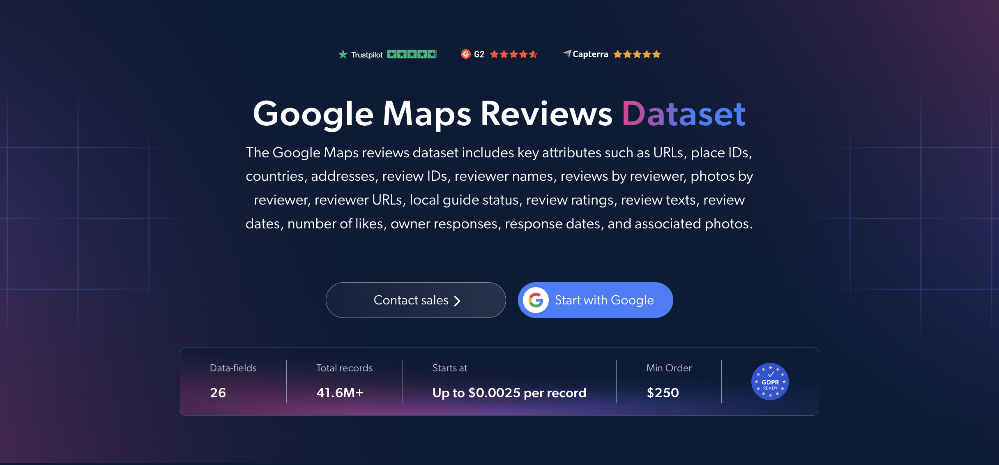

# Google-Maps-Reviews-dataset-samples

<h2>A sample dataset of 1000 Google Maps reviews</h2>

<a href="https://brightdata.com/products/datasets/google-maps/reviews">
   
</a>

A Google Maps reviews dataset sample of 1000 reviews of businesses and places. Dataset was extracted using the <b>Bright Data API</b>.

<h2>Some of the data points that are included in the dataset:</h2>

* ```url```: URL of the place on Google Maps
* ```place_id```: Unique identifier for the place
* ```place_name```: Name of the place
* ```category```: Category or type of the business
* ```address```: Full address of the place
* ```country```: Country of the place
* ```place_general_rating```: Overall rating of the place
* ```overall_place_riviews```: Total number of reviews for the place
* ```review_id```: Unique identifier for the review
* ```review_rating```: Star rating given by the reviewer
* ```review```: Text content of the review
* ```review_date```: Date the review was posted
* ```review_details```: Additional details from the review
* ```number_of_likes```: Number of likes on the review
* ```photos```: Photos attached to the review
* ```reviewer_name```: Name of the reviewer
* ```reviews_by_reviewer```: Total number of reviews written by the reviewer
* ```local_guide```: Whether the reviewer is a Google Local Guide
* ```response_of_owner```: Business owner's response to the review
* ```response_date```: Date of the owner's response

And a lot more.

This is a sample subset which is derived from the "Google Maps Reviews (public data)"
dataset which includes more than <b>41,600,000 reviews</b>.

Available dataset file formats: <b>JSON, NDJSON, JSON Lines, CSV, or Parquet. Optionally, files can be compressed to .gz</b>.

Dataset delivery type options: <b>Email, API download, Webhook, Amazon S3, Google Cloud storage, Google Cloud PubSub, Microsoft Azure, Snowflake, SFTP</b>.

Update frequency: <b>Once, Daily, Weekly, Monthly, Quarterly, Biannual, or Custom basis</b>.

Data enrichment available as an addition to the data points extracted: <b>Based on request.</b>

<b>[Get the full Google Maps Reviews dataset](https://brightdata.com/products/datasets/google-maps/reviews)</b>.

<a href="https://brightdata.com/products/datasets/google-maps/reviews">
</a>

<h2>What are the Google Maps Reviews datasets use cases?</h2>

<h3>1. Business intelligence and competitor benchmarking</h3>
Businesses use Google Maps reviews datasets to analyze review text and star ratings for their own locations and their competitors'. Comparing overall place ratings and review sentiment within a category reveals weak spots, customer expectations and opportunities to improve sales and marketing strategies.

<h3>2. Location-based marketing</h3>
Marketers analyze what customers say about places by address, category and review date. This highlights popular destinations and shifting preferences in each area, helping teams tailor local campaigns and decide where to focus their efforts.

<h3>3. Owner response tracking</h3>
Companies track how often and how quickly businesses respond to reviews, and which reviews come from Local Guides. This helps benchmark customer care across locations and competitors, and shows how owner engagement relates to ratings over time.

<h2>Free access to web scraping tools and datasets for academic researchers and NGOs</h2>

The Bright Initiative offers access to Bright Data's <b>[Web Scraper APIs](https://brightdata.com/products/web-scraper)</b> and <b>[ready-to-use datasets](https://brightdata.com/products/datasets)</b> to leading academic faculties and researchers, NGOs and NPOs promoting various environmental and social causes. You can submit an application <b>[here](https://brightinitiative.com)</b>.
